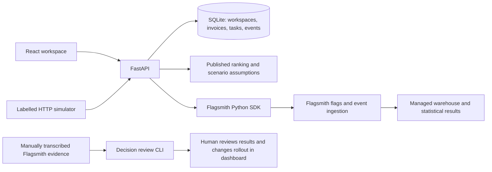

# ATLAS — Business Operations Intelligence

**Track 1: Test Something Real · Toggle Wars · Team THE EYE · Dhruv Sharma**

A finance operator sees overdue balances, but still has to decide where to act. ATLAS connects customers, invoices, disputes, scenarios, and reviewed tasks. The first module is cash and receivables; the broader product is a business operations workspace.

## What works

- Standard invoice register and a ranked decision workspace with a top-three brief.
- USD receivables, aging buckets, customer concentration, search, filters, and invoice drilldowns.
- Customer → invoice → dispute/task relationship explorer.
- Repeatable illustrative Monte Carlo cash receipts and concentration HHI.
- Customer payment-delay funding-cost scenarios with visible assumptions.
- CSV import, currency/date/amount validation, and CSV export.
- Reviewed internal tasks, server validation, persistent audit records, and JSON audit export.
- Flagsmith server-side assignment, display-confirmed exposure, and deduplicated conversion events.
- Experiment Lab, synthetic HTTP traffic, and a conservative evidence-review CLI.

Sample organisation, customers, and amounts are fictional. The prototype has 12 sample invoices and six customers. It does not connect to BlackRock, Palantir, a bank, or an ERP. The simulations demonstrate explicit assumptions; they do not establish forecast accuracy or recovery uplift.

## Run locally

Requirements: Python 3.11+ and Node 22.12+.

From this directory:

```sh
python3 -m venv .venv
.venv/bin/python -m pip install -r backend/requirements.txt
cp .env.example .env
.venv/bin/python -m uvicorn backend.main:app --reload --host 127.0.0.1 --port 8000
```

In a second terminal:

```sh
cd frontend
npm ci
npm run dev
```

Open **http://127.0.0.1:5173**. The frontend proxies `/api` to port 8000. Demo mode needs no API keys. Open **Experiment lab** to preview both variants; each preview creates a fresh sample workspace and is excluded from experiment counts.

The sample snapshot is **25 November 2026**. Imported invoices use the backend's current date; USD is the only supported currency. Import replaces the current workspace's invoice dataset before tasks exist. Enrolled live sessions cannot import, preserving a common experiment task.

## How Flagsmith is used

| Item | Implementation |
|---|---|
| Flag | `collections_workspace` |
| Values/keys | `control` and `decision_brief` |
| Evaluation | `get_identity_flags(...).get_flag(...)` in `backend/main.py` |
| Exposure | `track_exposure_event(...)` only after `/api/exposure` confirms the workspace displayed |
| Primary event | `valid_collection_action`, numeric value = server-measured seconds since first exposure |
| Conversion | Correct task type, non-empty review note, fixed top-five priority customer, within 600 seconds |
| Guardrails | `low_priority_action` and `invalid_action_attempted` occurrence; mean primary-event value |
| Failure | Non-enrolled control fallback; no experiment event submission |
| Durability | SQLite session token, first exposure, tasks, conversions, and event outbox |

The SDK reference explicitly supports separate evaluation and exposure when rendering happens later. This avoids enrolling visitors merely because an API response was fetched. Refreshes retain the anonymous identity and first exposure time. Server keys stay on the backend. Browser UUID and bearer token are pseudonymous workspace access, not enterprise authentication.

SDK-accepted events are **not confirmed warehouse delivery**. Pending exceptions retry on subsequent actions, but there is no independent retry worker yet. An SDK/network timeout can produce an ambiguous delivery outcome. Occurrence metrics handle duplicate conversion submissions; exactly-once transport is not claimed. The Lab shows local audit counts, never invented Bayesian results.

Configure live mode using [the setup guide](docs/flagsmith-setup.md). Use a separate environment/database for synthetic traffic and for genuine human sessions.

## Architecture



## Verify

```sh
.venv/bin/python -m pytest -q
cd frontend
npm run build
npm run test:e2e
```

Browser tests need both servers running and a Playwright Chromium installation (`npx playwright install chromium`). An existing Chrome binary can be selected with `CHROMIUM_PATH`. Tests cover both variants, a real approved task, audit visibility, relationship/scenario views, CSV import/export, and 375/768/1440px layouts.

Run a small labelled synthetic pipeline check:

```sh
.venv/bin/python simulator/simulate.py --visitors 100 --model null
```

`null` gives both variants a programmed 30% action probability. `effect` uses 30% for A and 38% for B. These are assumptions, not measured behaviour. Default think time is zero, so simulator latency must not be presented as human task duration. Live traffic requires `--allow-live` and a dedicated synthetic environment. A null model is not itself a full UI A/A test.

Review real Flagsmith evidence after filling the template:

```sh
.venv/bin/python tools/review_decision.py docs/results-template.json
```

Missing evidence returns KEEP RUNNING. The tool never ends an experiment or modifies flags. No admin key is needed for this first version.

## Status and next work

Live Flagsmith experiment setup, warehouse delivery confirmation, hosted deployment, actual A/A study, credible intervals, and submission video remain pending. The PDF's payment-history survival model, calibrated PD/LGD, AI drafts, and agent traffic are roadmap items. See [product and stack](docs/product-and-stack.md), [experiment plan](docs/experiment-plan.md), and [research](docs/research.md).

This local prototype began on 25 November 2026 at the user's explicit request after the current event start rule was explained. Preserve accurate history and disclose pre-event work; restarting commit history does not undo earlier work. Eligibility should be resolved with the organisers before submission.
